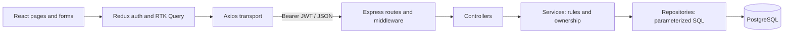
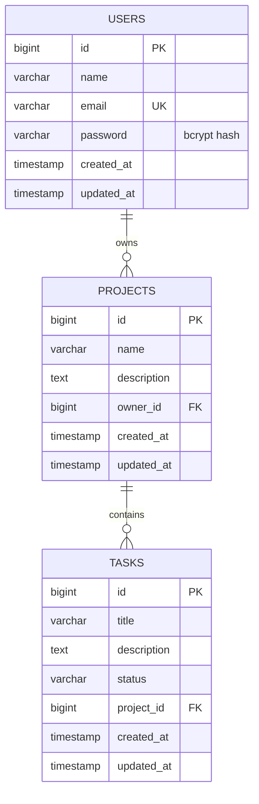

# Architecture and design boundaries

## Current system

Development requests normally pass through the Vite `/api` proxy. There is no
separate API gateway, WebSocket layer, AI service, Redis cache, or vector store.

## Backend responsibilities

| Directory | Responsibility | Change here when... |
| --- | --- | --- |
| `routes/` | HTTP paths, JWT middleware, async wrappers | Adding an endpoint |
| `controllers/` | Read request fields; choose HTTP response | Changing request/response contracts |
| `services/` | Validation, business rules, ownership checks | Changing allowed behavior |
| `repositories/` | Parameterized SQL and row mapping | Changing persistence/query behavior |
| `middleware/` | Authentication and error forwarding/serialization | Changing cross-cutting request handling |
| `config/` | Shared PostgreSQL pool and connection check | Changing database connection setup |
| `utils/` | JWT, bcrypt, application error helpers | Changing shared low-level behavior |

`app.js` registers routers and starts the server after `SELECT 1` succeeds.
Rejected handlers flow through `asyncHandler` to `errorHandler`. Application
errors carry `statusCode`; other errors currently become 500 responses containing
their message. Sanitizing unexpected errors is tracked as a follow-up.

### Authentication and authorization

Registration hashes passwords with bcrypt. Login signs a JWT containing `id`,
`email`, and `name`, with a three-day expiry. Protected routers verify the signature
and expiry and attach the payload to `req.user`.

Project lists and dashboard queries filter by owner. Project item operations load
the row and compare `owner_id` with the verified identity. Task collection operations
check the URL's project; task item operations authorize through the task's stored
`project_id`. Repositories do not authorize independently, so calling a repository
directly from a new controller would bypass the service boundary.

Task item routes currently do not ensure the URL's `projectId` matches the stored
parent. Ownership still applies, but the nested URL contract needs tightening.
See [known gaps](verification.md#known-gaps-and-priorities).

## Frontend responsibilities

- `routes/router.jsx` defines public and protected paths and lazy feature pages.
- `main.jsx` composes Redux, theme, render-error, and Suspense providers.
- `store/slices/authSlice.js` restores a non-expired token from localStorage.
  Login uses `thunks/authThunk.js`; registration uses an RTK Query mutation.
- `apis/axios.js` attaches tokens and redirects expired/invalid sessions. JWT
  decoding in the browser supports navigation; it does not verify signatures.
- `apis/baseQuery.js` adapts Axios results to RTK Query's data/error contract.
- Projects and tasks use list/entity cache tags in separate API slices. Tags do
  not cross slice boundaries. Dashboard data is not invalidated by their mutations.
- React Hook Form uses Zod for client validation. `Select` is controlled through
  `Controller`; it is not a native select.
- Theme context updates the root `dark` class and persists `theme` in localStorage.
  Shared tokens/styles live in `src/index.css` and `src/styles/global.css`.

Render failures, router errors, API errors, and lazy loading use separate boundaries.
An Error Boundary does not catch errors from event handlers or network requests.
API state is rendered by the pages/forms that own the request.

### Browser routes

| Route | Access | Purpose |
| --- | --- | --- |
| `/` | Public | Minimal welcome screen; full landing page deferred |
| `/register`, `/login` | Unauthenticated users | Account registration and login |
| `/dashboard` | Authenticated | Statistics and recent records |
| `/projects` | Authenticated | Project list and create modal |
| `/createProject` | Authenticated | Legacy direct form route; see known gaps |
| `/projects/:projectId` | Authenticated | Project detail/edit and its tasks |
| Any other path | Public fallback | Not-found page |

Task creation/editing happens inside project details; there is no standalone
`/tasks` route. `ProtectedRoute` is a UI guard; the API remains authoritative.

## Data model

See [schema.sql](../backend/db/schema.sql) for exact lengths and nullability.
PostgreSQL `BIGINT` identifiers are returned as strings by the current pg driver;
preserve that representation in tokens and ownership comparisons. Do not convert
IDs to JavaScript numbers without considering precision and existing comparisons.

Deleting a project cascades to its tasks at the database layer. Deleting users is
not exposed by the API. Status is validated by the service, not a database CHECK.
Timestamps use `TIMESTAMP` without timezone; update queries explicitly change
`updated_at`, and no triggers maintain it automatically.

Dashboard recent lists use `created_at DESC LIMIT 5`. They are not a separate audit
log and do not record edit/delete events. Counts are calculated in separate SQL
queries, so a report is not guaranteed to represent a single transaction snapshot.

## Decisions to preserve or revisit deliberately

| Decision | Current reason / implication |
| --- | --- |
| Layered Express backend | Keeps HTTP, business rules, and SQL separable |
| Direct pg queries | Existing V1 persistence; no ORM or migration framework |
| Token in localStorage | Existing session persistence; revisit for production/XSS protection |
| Separate RTK Query slices | Existing feature organization; cross-feature invalidation needs explicit work |
| BrowserHistory routing | Hosts must serve the SPA entry for deep links |
| SQL bootstrap instead of inferred migration history | Reproduces the inspected schema without inventing past migrations |

For a substantial change, add the decision, alternatives, and migration impact to
this document or a focused linked decision record before merging.
